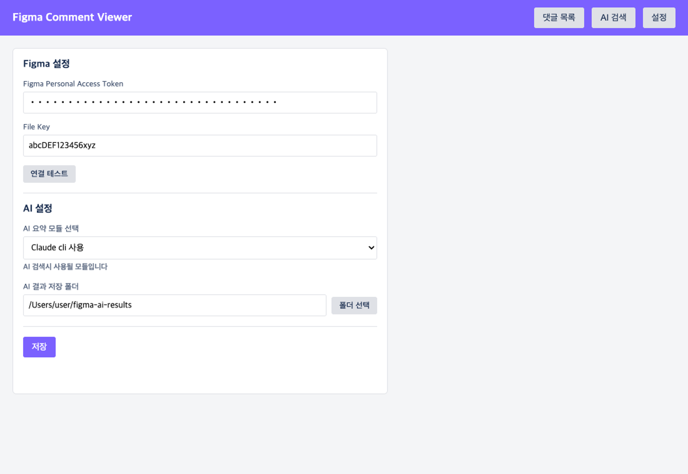
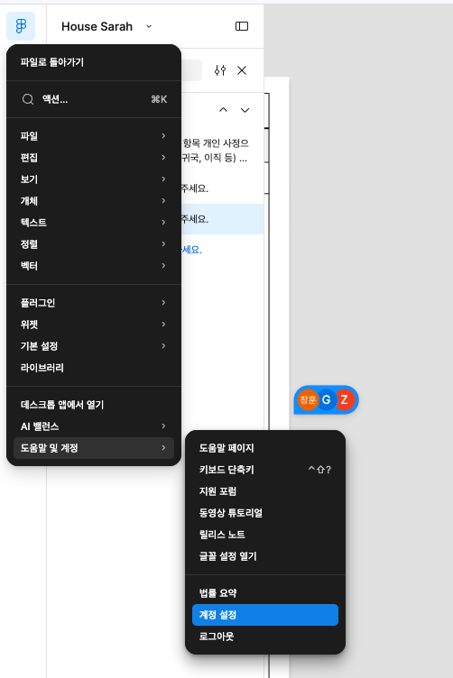
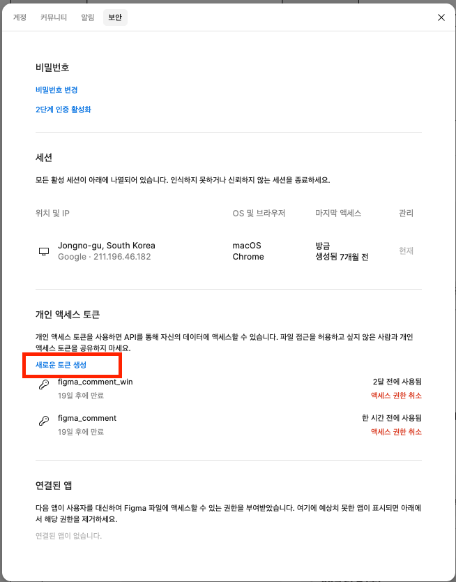
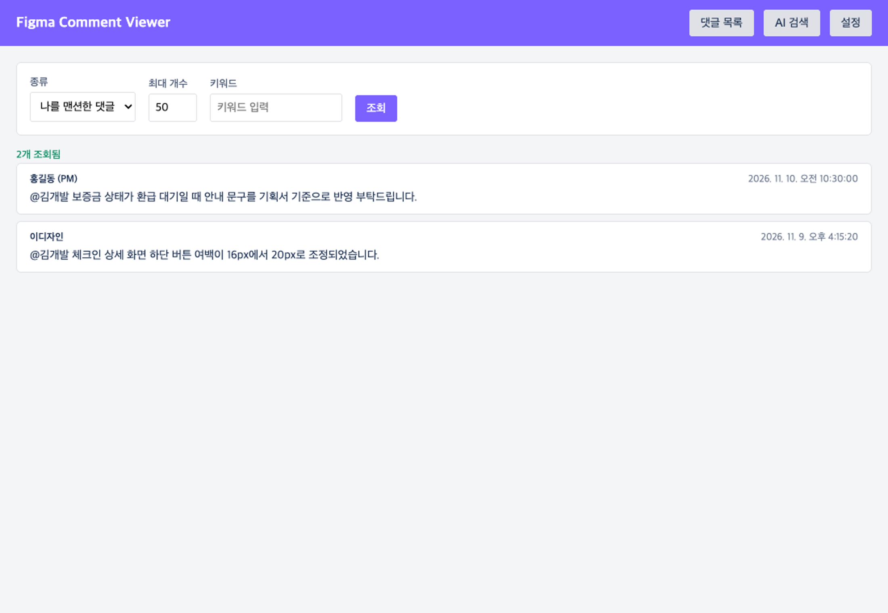
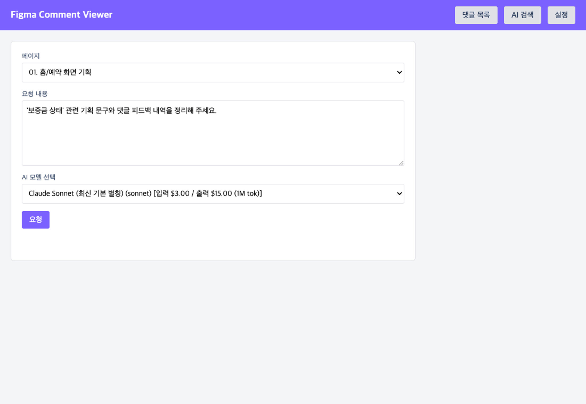

# FigCommi 사용자 가이드

> ⚠️ **보안 및 사용 주의사항**  
> **해당 앱은 사내에서만 사용해주세요. 외부에서 사용하시면 안됩니다.**

**FigCommi**(`/Applications/FigCommi.app`)는 Figma 파일의 댓글(멘션/내가 쓴 댓글)을 빠르게 조회·답글 작성하고, 선택한 페이지의 기획 텍스트 노드와 댓글 쓰레드를 **AI(Claude CLI 등)**로 종합 분석하여 마크다운 보고서로 생성해 주는 데스크톱 앱입니다.

---

## 목차
1. [앱 설치 방법 (`/Applications/FigCommi.app`)](#1-앱-설치-방법-applicationsfigcommiapp)
2. [초기 설정 셋팅 (`설정` 탭)](#2-초기-설정-셋팅-설정-탭)
   - [2.1 Figma 설정 (Personal Access Token & File Key)](#21-figma-설정-personal-access-token--file-key)
   - [2.2 AI 설정 (`Claude cli 사용` 예시)](#22-ai-설정-claude-cli-사용-예시)
3. [댓글 목록 조회 및 상세 보기 (`댓글 목록` 탭)](#3-댓글-목록-조회-및-상세-보기-댓글-목록-탭)
4. [AI 검색 및 기획/댓글 분석 (`AI 검색` 탭)](#4-ai-검색-및-기획댓글-분석-ai-검색-탭)

---

## 1. 앱 설치 방법 (`/Applications/FigCommi.app`)

1. 전달받은 설치 이미지 파일(`FigCommi-1.0.0-arm64.dmg`)을 다운로드합니다.
2. `.dmg` 파일을 더블클릭하여 설치한 후 실행하기 전에, **터미널(Terminal)**을 열고 아래 명령어를 실행하여 macOS 검역 속성을 해제합니다.
   ```bash
   xattr -cr /Applications/FigCommi.app
   ```
   *(참고: 다운로드한 `.dmg` 파일을 더블클릭하기 전에 `xattr -cr ~/Downloads/FigCommi-1.0.0-arm64.dmg`를 먼저 실행하거나, `Applications` 폴더에 앱을 복사한 뒤 `xattr -cr /Applications/FigCommi.app`를 실행하면 "파일이 손상되었기 때문에 열 수 없습니다" 오류 없이 정상 실행됩니다.)*
3. `FigCommi-1.0.0-arm64.dmg` 파일을 더블클릭하여 마운트하고, 열리는 설치 창에서 **`FigCommi.app`** 아이콘을 **`Applications` (응용 프로그램)** 폴더로 드래그 앤 드롭하여 `/Applications/FigCommi.app` 경로에 설치합니다.
4. 설치가 완료되면 응용 프로그램 폴더(`/Applications/FigCommi.app`) 또는 Spotlight에서 **FigCommi**를 실행합니다.

---

## 2. 초기 설정 셋팅 (`설정` 탭)

앱을 처음 실행하거나 우측 상단 내비게이션 바에서 **[설정]** 탭을 클릭하면 Figma 연동 정보와 AI 분석 모듈을 설정할 수 있습니다.



---

### 2.1 Figma 설정 (Personal Access Token & File Key)

#### ① Figma Personal Access Token 발급받기

1. **계정 설정 열기**: Figma 화면 좌측 상단 아이콘을 클릭한 뒤 **[도움말 및 계정] → [계정 설정]**을 클릭합니다.

   

2. **개인 액세스 토큰 생성**: 계정 설정 모달 상단에서 **[보안]** 탭을 선택한 뒤, **개인 액세스 토큰** 영역의 **[새로운 토큰 생성]**을 클릭합니다.

   

3. 토큰 이름(예: `figma_comment`)과 만료 기간/권한(`File content`, `Comments` 읽기/쓰기 권한)을 지정하고 생성된 토큰(`figd_...`으로 시작하는 문자열)을 복사하여 FigCommi 설정 화면의 **`Figma Personal Access Token`** 입력란에 붙여넣습니다.

#### ② File Key 확인 및 입력하기
분석 및 조회할 Figma 디자인 파일의 웹 URL에서 **`File Key`**를 확인할 수 있습니다.

```text
https://www.figma.com/design/abcDEF123456xyz/프로젝트-기획서?node-id=0-1
                             ^^^^^^^^^^^^^^^
                             이 부분이 File Key 입니다.
```

- URL의 `/design/`(또는 `/file/`) 바로 뒤에 위치한 영문·숫자 조합 문자열(예: `abcDEF123456xyz`)을 복사하여 **`File Key`** 입력란에 입력합니다.
- **[연결 테스트]** 버튼을 클릭했을 때 하단에 `연결 성공: 사용자핸들 (id: ...)` 메시지가 표시되면 정상 연동된 것입니다.

---

### 2.2 AI 설정 (`Claude cli 사용` 예시)

FigCommi는 AI 검색 시 사용할 엔진으로 **Claude CLI**, **Antigravity CLI**, **GitHub Copilot SDK**를 지원합니다. 아래는 **`Claude cli 사용`**을 기준으로 한 설정 방법입니다.

#### ① 사전 준비 (Claude CLI 설치 및 인증 확인)
로컬 PC 터미널에서 `claude` 명령어가 실행 가능하고 로그인되어 있어야 합니다.
```bash
# 설치 및 버전 확인
claude --version

# 최초 1회 로그인 확인 (미로그인 시 실행하여 인증 진행)
claude
```

#### ② FigCommi에서 AI 설정 입력
1. **AI 요약 모듈 선택**: 드롭다운에서 **`Claude cli 사용`**을 선택합니다.
   - `Claude cli 사용`을 선택하면 로컬에 로그인된 Claude CLI 환경을 그대로 사용하므로 별도의 GitHub 토큰 입력란은 자동으로 숨겨집니다.
2. **AI 결과 저장 폴더**: **[폴더 선택]** 버튼을 클릭하여 AI가 분석한 마크다운(`.md`) 결과 파일이 저장될 로컬 폴더 경로를 지정합니다.
   - 기본 경로는 `~/figma-ai-results` (`/Users/사용자계정/figma-ai-results`)로 자동 설정됩니다.
3. 하단의 **[저장]** 버튼을 클릭하여 설정을 저장합니다 (`저장되었습니다.` 메시지 확인).

---

## 3. 댓글 목록 조회 및 상세 보기 (`댓글 목록` 탭)

상단 메뉴에서 **[댓글 목록]** 탭을 클릭하면 설정된 Figma 파일의 댓글을 조건별로 필터링하여 조회할 수 있습니다.



### ① 댓글 검색 및 필터링
- **종류**:
  - `나를 맨션한 댓글`: 댓글 본문에 내 계정(`@handle` 또는 사용자 ID)이 멘션된 댓글만 필터링합니다.
  - `내가 쓴 댓글`: 내가 작성한 댓글만 필터링합니다.
- **최대 개수**: 한 번에 표시할 최신순 댓글 개수(기본 `50`개, 최대 `500`개)를 지정합니다.
- **키워드**: 특정 단어가 포함된 댓글만 찾고 싶을 때 입력합니다 (비워두면 전체 조회).
- **[조회]** 버튼을 클릭하면 조건에 맞는 댓글 목록이 최신순으로 표시됩니다.

### ② 댓글 상세 화면 (디자인 미리보기 & 쓰레드 답글)
목록에서 원하는 댓글 항목을 클릭하면 **댓글 상세 화면**으로 이동합니다.
- **좌측 (디자인 미리보기)**:
  - 댓글이 연결된 Figma 노드(`node_id`)의 디자인 프리뷰 이미지와 댓글 핀 위치가 표시됩니다.
  - 미리보기 이미지를 클릭하면 원본 해상도(`scale=1`) 이미지를 새 창으로 확대해서 볼 수 있습니다.
  - 우측 상단 **[Figma 상세보기]** 버튼을 클릭하면 Google Chrome(또는 기본 브라우저)에서 해당 Figma 디자인 노드 및 댓글 위치가 즉시 열립니다.
- **우측 (쓰레드 및 답글 작성)**:
  - 해당 댓글에 달린 전체 대화(쓰레드) 내역을 시간순으로 확인할 수 있습니다.
  - 하단 입력창에 내용을 입력하고 **[답글 전송]**을 클릭하면 Figma 해당 댓글 쓰레드로 답글이 바로 등록됩니다.

---

## 4. AI 검색 및 기획/댓글 분석 (`AI 검색` 탭)

상단 메뉴에서 **[AI 검색]** 탭을 클릭하면 Figma 파일 내 특정 페이지의 기획 텍스트(`TEXT` 노드)와 댓글 쓰레드를 종합 분석할 수 있습니다.



### ① AI 검색 요청하기
1. **페이지 선택**:
   - 설정된 Figma 파일의 최상위 페이지(`CANVAS`) 목록이 자동으로 불러와집니다. 분석할 대상 페이지를 선택하세요.
2. **요청 내용 입력**:
   - 선택한 페이지의 기획 텍스트 및 댓글 데이터를 바탕으로 분석·요약할 내용을 자유롭게 입력합니다.
   - 💡 **팁**: 화면 내 특정 용어나 상태값(예: `'보증금 상태'`, `'체크인 안내'`)을 **따옴표(`'...'` 또는 `"..."`)**로 감싸서 질문하면, AI가 해당 구문을 필수 핵심 구문으로 인식하여 훨씬 정확하게 관련 화면과 노드를 찾아냅니다.
3. **AI 모델 선택 (실시간 목록 조회)**:
   - AI 검색 탭에 진입할 때마다 설정된 모듈(`Claude cli 사용`)에서 사용 가능한 모델 목록과 1M 토큰당 입/출력 단가를 **실시간으로 조회**합니다.
   - `기본값 (자동)`을 두거나 `Claude Sonnet (sonnet)`, `Claude Opus (opus)`, `Claude Haiku (haiku)` 등 원하는 모델을 선택합니다.
4. **[요청]** 버튼을 클릭하면 2단계 AI 분석 파이프라인이 실행됩니다:
   - **1단계**: 질문에서 핵심 구문과 검색 키워드를 AI로 추출
   - **2단계**: 페이지 내 모든 텍스트 노드와 댓글 쓰레드를 스코어링 후 종합 분석하여 마크다운 보고서 생성 및 저장

### ② 분석 결과 확인 및 활용
분석이 완료되면 **AI 데이터 분석 결과 팝업**이 자동으로 열립니다.
- **Figma 바로가기 링크 자동 연결**:
  - 분석 본문 및 하단 `관련 화면 · 관련 노드 · 참고 자료` 섹션에 포함된 **화면 이름**, **노드 ID**, **댓글 쓰레드 번호(`#ID`)**를 클릭하면 외부 브라우저에서 해당 Figma 위치가 새 창으로 바로 열립니다.
- **[클립보드 복사]**: 생성된 마크다운 원문을 클립보드에 복사하여 노션, 슬랙, 지라 등에 바로 붙여넣을 수 있습니다.
- **[저장된 파일 위치 열기]**: 설정한 저장 폴더(`~/figma-ai-results/figma_ai_YYYYMMDD_HHMMSS.md`)에 저장된 마크다운 파일을 Finder(탐색기)에서 바로 엽니다. 저장된 `.md` 파일 내부의 모든 링크에도 새 창 열기(`target="_blank"`)가 적용되어 있어 어떤 마크다운 뷰어에서도 편리하게 열람할 수 있습니다.
- 팝업을 닫은 뒤에도 **[최근 분석 결과 보기]** 버튼을 눌러 마지막 분석 결과를 언제든 다시 확인할 수 있습니다.

